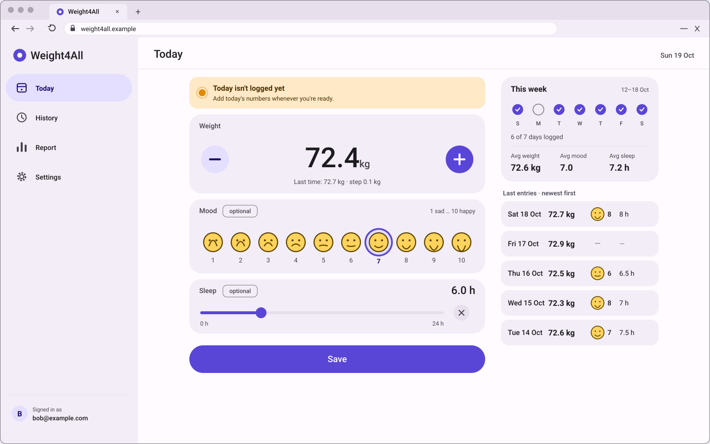
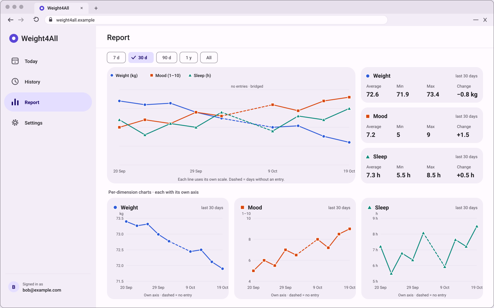
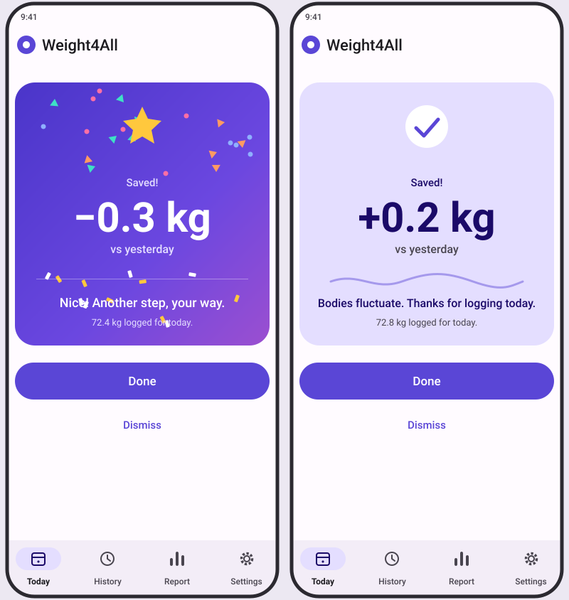

# Weight4all

A personal daily tracker for **body weight, mood and sleep**, built as a responsive web app (phone, tablet and desktop) with Angular and Firebase.

The project has two goals:

1. **A tool you own.** Each day you log three values in one fast screen, then see how they move together in a report.
2. **Learning the [BMad Method](https://docs.bmad-method.org/) end to end.** The whole app was planned and built with BMad, from the first idea to the stories and tests. This README explains what the app does and how BMad was used. The documents that record each step are in `_bmad-output/` and `docs/`.

---

## What the app does

Every day you record three values:

| Value | Input | Rule |
| --- | --- | --- |
| Weight | kg | Required. One per day. |
| Mood | 1 to 10, shown as faces | Optional. |
| Sleep | hours (slider, starts at 6.0 h) | Optional. |

A weight-only day is valid. The app has these screens:

- **Today**: one screen to log the day. After saving you get a warm, never-shaming response that compares with yesterday. If today has no entry, a visible sign reminds you (no emails or push notifications).
- **History**: browse past days, edit an entry, add a forgotten day, or delete one safely.
- **Report**: one combined chart of all three values, plus a chart and statistics (average, min, max, change) for each value. You can pick a range (7 days, 30 days, 90 days, 1 year, or all). Missing days appear as dashed gaps, and statistics use real entries only.
- **Settings**: language (English or Italian), accent color, and account.

Each account sees only its own data. Access and data shape are enforced by Firestore security rules.

**Scope (v1):** web app only. No installable app (PWA), no offline mode, no data export. Later ideas (physical activity, diet, correlation insights) are parked in the product brief addendum.

---

## Planned UI

The screens below are the mockups from the UX phase of the BMad planning. They show how the finished product should look and behave. The design rules are in [`DESIGN.md`](_bmad-output/planning-artifacts/ux-designs/ux-bmad612_home-2026-10-19/DESIGN.md) (look, colors, tokens) and [`EXPERIENCE.md`](_bmad-output/planning-artifacts/ux-designs/ux-bmad612_home-2026-10-19/EXPERIENCE.md) (behavior).

### Today: logging the day (desktop)



### Report: the three values over time (desktop)



### Happy feedback after saving (phone)



### All mockups

| Screen | Device | File |
| --- | --- | --- |
| Today: logging the day | Desktop | [desktop-01-today.svg](_bmad-output/planning-artifacts/ux-designs/ux-bmad612_home-2026-10-19/mockups/desktop-01-today.svg) |
| Report with charts | Desktop | [desktop-02-report.svg](_bmad-output/planning-artifacts/ux-designs/ux-bmad612_home-2026-10-19/mockups/desktop-02-report.svg) |
| Today: logging the day | Tablet | [tablet-01-today.svg](_bmad-output/planning-artifacts/ux-designs/ux-bmad612_home-2026-10-19/mockups/tablet-01-today.svg) |
| Report with charts | Tablet | [tablet-02-report.svg](_bmad-output/planning-artifacts/ux-designs/ux-bmad612_home-2026-10-19/mockups/tablet-02-report.svg) |
| Today: logging the day | Phone | [mock-01-today.svg](_bmad-output/planning-artifacts/ux-designs/ux-bmad612_home-2026-10-19/mockups/mock-01-today.svg) |
| Happy effect after saving | Phone | [mock-02-happy-effect.svg](_bmad-output/planning-artifacts/ux-designs/ux-bmad612_home-2026-10-19/mockups/mock-02-happy-effect.svg) |
| History of entries | Phone | [mock-03-history.svg](_bmad-output/planning-artifacts/ux-designs/ux-bmad612_home-2026-10-19/mockups/mock-03-history.svg) |
| Report with charts | Phone | [mock-04-report.svg](_bmad-output/planning-artifacts/ux-designs/ux-bmad612_home-2026-10-19/mockups/mock-04-report.svg) |
| Settings: accent color, language, account | Phone | [mock-05-settings.svg](_bmad-output/planning-artifacts/ux-designs/ux-bmad612_home-2026-10-19/mockups/mock-05-settings.svg) |

A browsable version with all the mockups is in [`mockups/index.html`](_bmad-output/planning-artifacts/ux-designs/ux-bmad612_home-2026-10-19/mockups/index.html). Open it in a browser.

---

## How BMad was used

The project follows the BMad **full path**: analysis, planning, architecture, epics and stories, a build loop per epic, then a retrospective. BMad version installed in this repo: **6.12.4** (modules `core`, `bmm`, `bmb`).

```
PLANNING (once, for the whole product)
  Brief  →  PRD  →  UX (DESIGN.md + EXPERIENCE.md)  →  Architecture
  →  Epics and stories  →  Readiness check  →  Sprint status

BUILD (one loop per epic)
  For each story:  build → code review → end-to-end tests
  End of epic:     retrospective and closure
```

### Planning artifacts

All planning outputs are in `_bmad-output/planning-artifacts/`:

| Artifact | What it contains |
| --- | --- |
| `briefs/` | Product brief: problem, solution, target user, and an addendum with parked ideas. |
| `prds/` | Product Requirements Document: 29 functional requirements (FR-1 to FR-29), user journeys, glossary, and scope. |
| `ux-designs/` | `DESIGN.md` (look and feel, tokens, accent palette), `EXPERIENCE.md` (behavior), and mockups for phone, tablet and desktop. |
| `architecture/` | `ARCHITECTURE-SPINE.md`: 15 numbered decisions (AD-1 to AD-15), coding conventions, stack versions, and the structure of the code. Also a solution design and validation reports. |
| `epics.md` | 5 epics and 34 stories, each with acceptance criteria, mapped to the requirements. |

Before any build started, the planning was checked for readiness. The first check returned **CONCERNS**, the issues were fixed (new stories, a PRD update), and the second check passed.

### Brainstorming

`_bmad-output/brainstorming/` holds the session where the product ideas were explored and the user chose what goes into v1.

### Implementation

`_bmad-output/implementation-artifacts/` holds:

- `sprint-status.yaml`: the status of every epic and story, the tracking file for the sprint.
- `spec-N-M-*.md`: one implementation spec per story (34 in total), with the work done and its checks.
- `epic-N-context.md`: context notes for each epic.
- `deferred-work.md`: items found during review that were postponed on purpose.

### Feature map

Each epic is one feature. The order is fixed, because each feature builds on the previous one. The step-by-step instructions for each feature are in `docs/features/`.

| Epic | Feature | Stories | Status |
| --- | --- | --- | --- |
| 1 | Foundations and adaptive shell: project, Firebase, languages, theme, sign-up, login, password reset, four tabs, accent color | 10 | In review |
| 2 | Daily weight entry: save, quick adjust, history, edit, delete, "this week" | 10 | In review |
| 3 | Mood and sleep: face scale and sleep slider | 3 | In review |
| 4 | Report: range, statistics, per-value charts, combined chart, responsive layout | 5 | In review (4.5 done) |
| 5 | Polish: accessibility, layout across browsers, performance, end-to-end journeys, safe release | 6 | In progress (5.1, 5.2 done) |

The overview of the whole project and the BMad approach is in `docs/weight4all.md`. The planning commands are in `docs/planning.md`.

### Working rules used

- Each BMad skill runs in a **fresh chat**. The context comes from the file produced, not from the conversation.
- Every planning artifact is **validated** before the next phase starts.
- If you are lost, ask `/bmad-help <your question>`.

---

## Technology

| Area | Choice |
| --- | --- |
| Frontend | Angular 22, Angular Material (Material 3), TypeScript |
| Charts | Chart.js with ng2-charts |
| Backend | Firebase Auth and Cloud Firestore (modular SDK 12) |
| Tests | Vitest (unit and architecture lint), Firestore rules tests, Playwright (end to end) |
| Tooling | Firebase CLI and Emulator Suite |

The code is organized by feature. Shared calculations live in a pure `domain` folder, and only `core/data` talks to Firebase.

---

## Repository layout

| Folder | Content |
| --- | --- |
| `src/app/` | Application code: `features/` (auth, today, history, report, settings), `shell/`, `domain/`, `core/` |
| `src/environments/` | Environment files (see the Firebase configuration section below) |
| `e2e/` | End-to-end tests: key journeys, layout, performance, state, grayscale check |
| `tests/` | Lint fixtures and Firestore rules tests |
| `scripts/` | Emulator start, test account setup, rules test runner |
| `docs/` | Project overview, planning commands, feature instructions |
| `_bmad/` | BMad installation: modules, configuration, and skills |
| `_bmad-output/` | Everything BMad produced: brainstorming, planning, implementation |

---

## Prerequisites

- Node.js `>= 24.15.0` (see `engines` in `package.json`)
- npm
- Java 11+ (required by the Firebase emulators)
- Windows: `start-emulators.bat` and `start-app.bat` start everything with a double-click

## Installation

```bash
npm install
```

## Firebase configuration

The project uses two environments:

| Environment | File | Firebase |
| --- | --- | --- |
| `local` (development and tests) | `src/environments/environment.ts` | Local emulators (`demo-weight4all`), no real data |
| `prod` (production build) | `src/environments/environment.prod.ts` | Real project `robyweight4all` |

The production project values are **not** in the repository. They are read from `src/environments/firebase.prod.values.ts`, which is ignored by git.

To set up the production build:

1. Copy the template file:
   ```bash
   cp src/environments/firebase.prod.values.example.ts src/environments/firebase.prod.values.ts
   ```
   On Windows, use `copy` instead of `cp`.
2. Open the new file and replace the placeholders with the real values, taken from Firebase Console > Project settings > Your apps > SDK setup and configuration.
3. Do not commit `firebase.prod.values.ts`.

Without this file, the production build and `firebase.spec.ts` will not compile.

## Development

Use the Firebase emulators so no real data is touched.

1. Start the emulators (Auth and Firestore):
   ```bash
   npm run emulators
   ```
   On Windows, run `start-emulators.bat`. It also creates the local test account.
2. In another terminal, start the app:
   ```bash
   npm start
   ```
   On Windows, run `start-app.bat`. The app is at `http://localhost:4200`.

Test account (emulator only): `prova.locale@weight4all.test` / `prova-locale-2026`.

To keep the emulator data, stop with `Ctrl+C` and answer `N` to "Terminate batch job". The data is saved in `.firebase-emulator-data/`.

## Build and deploy

```bash
npm run build      # production build (uses environment.prod.ts)
npm run check      # lint, tests and Firestore rules tests
npm run deploy     # check + firebase deploy
```

## Testing

```bash
npm test           # unit tests and architecture lint
npm run test:rules # Firestore rules tests (requires the emulators)
npm run e2e        # end-to-end tests with Playwright
```
