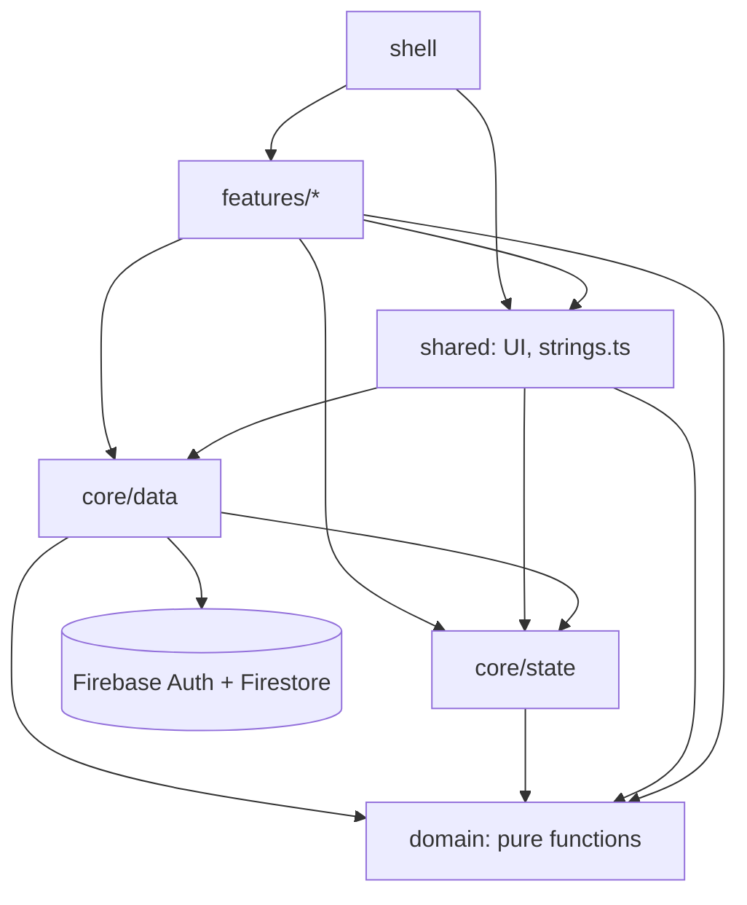
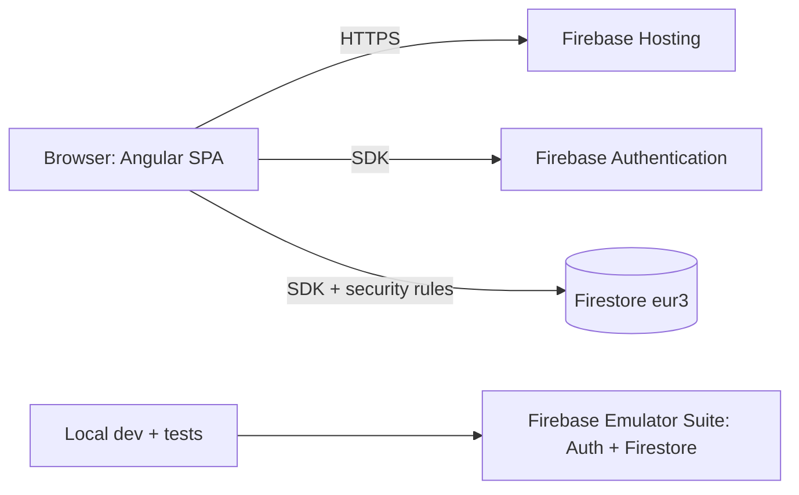
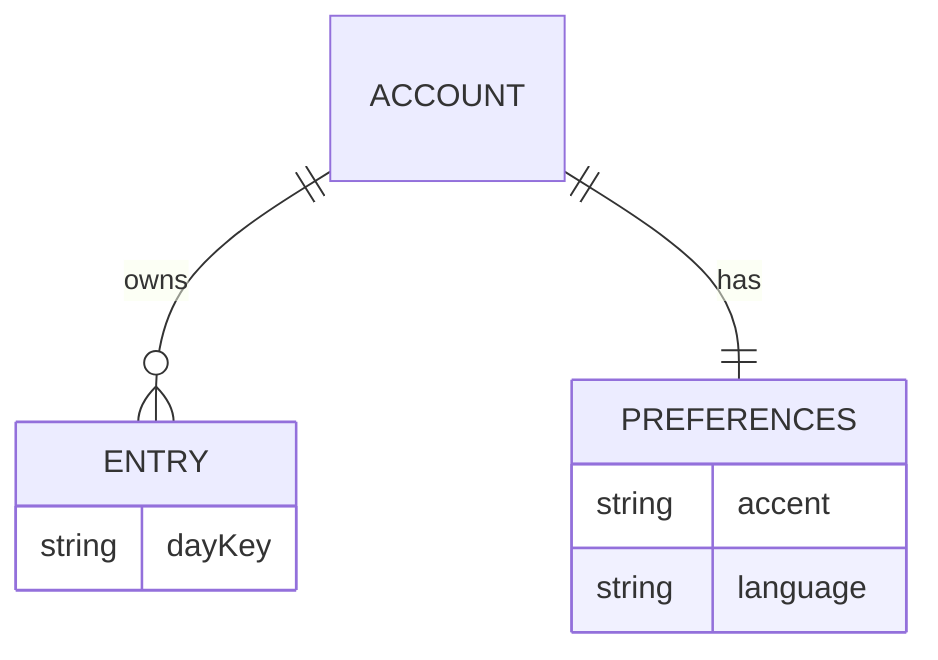

# Architecture Spine — Weight4All

## Design Paradigm

**Feature-sliced Angular single-page app with one data-access boundary.** Feature folders own their screens; a shared `domain` of pure functions owns all calculation; `core/data` is the only code that talks to Firebase.

| Layer | Directory | Owns |
| --- | --- | --- |
| Features | `src/app/features/{auth,today,history,report,settings}` | Screens, feature-local components, routes |
| Shell | `src/app/shell` | Navigation bar/rail, route table, route guards |
| Domain | `src/app/domain` | Pure functions and types: `entry`, `dimensions`, `day`, `series`, `stats`, `history`, `happy-effect`, `validation`, `number` |
| State | `src/app/core/state` | Firebase-free app state: `DraftStore`, `ClockService` (the `today` signal), `LayoutService` (the `windowClass` signal) |
| Data | `src/app/core/data` | `firebase.ts`, `AuthService`, `SessionScope`, `EntryStore`, `PreferencesStore` (owns the Language and accent signals) |
| Shared UI | `src/app/shared` | Reusable components incl. `EntryFormComponent`, theme, `strings.ts` |

Allowed imports (anything not listed is forbidden and enforced, AD-13):

| From | May import |
| --- | --- |
| `domain` | nothing outside `domain` |
| `core/state` | `domain` |
| `core/data` | `domain`, `core/state` |
| `shared` | `domain`, `core/*` |
| `features` | `domain`, `core/*`, `shared` |
| `shell` | `domain`, `core/*`, `shared`, `features` (routes only) |



`domain` imports nothing from Angular, Firebase or the DOM.

## Invariants & Rules

### AD-1 — One data boundary [ADOPTED]

- **Binds:** all, FR-4, FR-14, NFR-1
- **Prevents:** screens each calling Firestore their own way, so saves, errors and caching diverge.
- **Rule:** only files under `src/app/core/data/` may import `firebase/*` or `@firebase/*`. Everything else reads data through the signals of `EntryStore`, `PreferencesStore` and `AuthService` and calls their methods to write. Enforced by ESLint `no-restricted-imports` (AD-13).

### AD-2 — Entry: one per Day, flat optional fields, full-document writes [ADOPTED]

- **Binds:** F1, F2, FR-7, FR-15, FR-16, FR-17, NFR-2, NFR-5
- **Prevents:** a second Entry for a Day; a missing value stored as `0` or `null`; a unit mismatch between form, store and rules; one builder merging and another replacing.
- **Rule:** the domain type `Entry` (`domain/entry.ts`) is `{ day: DayKey, values: { [dimensionKey]: number } }`, with values always in display units (kg with one decimal, hours in half-hour steps, mood 1 to 10). It is the only shape that crosses between form, store, series and stats. In Firestore an Entry is the document `users/{uid}/entries/{YYYY-MM-DD}` with flat fields named exactly by Dimension key: `weight` (number, required, 20.0 to 400.0, one decimal), `mood` (integer 1 to 10), `sleep` (number 0 to 24, half-hour step), plus `updatedAt` (server timestamp). An absent value is an absent field, never `0` and never `null`. `EntryStore` alone owns `toDoc`/`fromDoc` (identity on values; it adds and drops `updatedAt`). `save` always writes the full document (`setDoc` without `merge`), so clearing a value omits the field. A new Dimension is a new optional flat field (no migration).

### AD-3 — Dimension registry is the only list of Dimensions

- **Binds:** F2, F3, FR-17, FR-19, FR-20, FR-21, NFR-2
- **Prevents:** forms, History, charts and Statistics each hard-coding `weight/mood/sleep`; Weight special cases scattered; the form switching on Dimension names.
- **Rule:** `domain/dimensions.ts` exports one ordered list and a `PRIMARY` constant (Weight). Each item has `key` (also the Firestore field name), `unit`, range, step, `decimals`, `required`, `clearable`, `input` (`stepper`, `faces` or `slider`), `defaultValue` (Sleep: 6.0, Mood: none, Weight: none), chart color token, chart marker, label key in `strings.ts`. Forms render the control named by `input`; History rows, Report charts and Statistics iterate the list. Weight-only behaviors (pre-fill from the last Entry, the Happy effect, the required rule) use `PRIMARY`. Outside `domain/dimensions.ts`, `firestore.rules` and tests, no code names a Dimension literally (AD-13).

### AD-4 — One module owns Days, Ranges and the clock

- **Binds:** F1, F3, FR-7, FR-10, FR-12, FR-18, FR-29, NFR-3
- **Prevents:** screens disagreeing on which Day an Entry belongs to or what a Range means; `new Date('YYYY-MM-DD')` showing the wrong day west of UTC; a stale "today" after midnight; two date formatters.
- **Rule:** `domain/day.ts` exports `dayKey(date)`, `parseDayKey`, `addDays`, `enumerateDays(from, to)`, `resolveRange(rangeId, today, firstDay)` and `formatDay(dayKey, locale, style)`. A key is the device-local `YYYY-MM-DD`; arithmetic is calendar-based, never millisecond-based. Ranges: `7d`, `30d`, `90d` and `1y` (365 Days) all end today; `all` starts at `firstDay` (the earliest Entry, or today when none). `ClockService` is the only code that reads the clock: it exposes a `today` signal refreshed at local midnight and on tab visibility change. "This week" and the Report's 7-day Range both come from `resolveRange`. Date construction and `Intl` date formatting happen only in `domain/day.ts` (AD-13). Creating an Entry for a Day later than `today` is blocked by the client only. Time-zone travel across midnight is an accepted edge.

### AD-5 — Load once, mutate only through EntryStore, confirm before showing

- **Binds:** F1, FR-9, FR-10, FR-14, FR-27, NFR-5
- **Prevents:** screens showing unsaved data as saved; two caches of one Entry; a write that hangs forever offline; inconsistent errors; a write landing in the wrong session.
- **Rule:** after a session exists, `EntryStore` loads all the user's Entries once (one ordered read) into a signal keyed by day, with `status` `loading | ready | error`. History, Report, "This week" and the Missing-entry sign are derived from it in memory; the Missing-entry sign shows only when `status` is `ready`. `save(entry)` and `remove(day)` are the only mutations and return `ok` or `error(code)` with `code` in `network | timeout | permission | invalid | unknown`. Each write is raced against a 10 s timeout (offline Firestore writes otherwise stay pending); on timeout the store reports `timeout`, leaves the signal unchanged and, before any next write for that Day, re-reads it with `getDocFromServer`, because the timed-out write may still commit later. The signal updates only after a confirmed write. Every read, write and re-read carries the `sessionEpoch` current when it started and is discarded if it differs (AD-9). Writes are full-document by id, so a retry is idempotent. Two devices: last write wins `[ASSUMPTION]`. No realtime listeners and no Firestore offline persistence. "Previous Entry" is computed in one place, `previousEntry(day, entries)` in `domain/history.ts`.

### AD-6 — Gaps are missing values, never zeros

- **Binds:** F3, FR-19, FR-21, FR-22, FR-23, FR-29
- **Prevents:** a missing Day or Dimension plotted as `0` or counted in an average; dashed bridging implemented differently per chart; charts with different axis bounds.
- **Rule:** `domain/series.ts` builds, per Dimension and Range, one point per Day with `value: number | null` over a shared category x-axis. A point whose segment from the previous Real entry crosses any Day without a value carries `bridgedFromPrev: true`, stored on the point that ends the segment. A single `chartDataset(dimension, series)` helper in `features/report` produces every dataset (combined and per-Dimension) with Chart.js `spanGaps: true`, a `segment.borderDash` callback reading `bridgedFromPrev` from `p1DataIndex`, and the axis bounds taken from the registry range and step. The combined chart uses one independent y axis per Dimension (real values, no normalization). A unit test asserts `p0DataIndex` and `p1DataIndex` for a series with null gaps. `domain/stats.ts` computes average, minimum, maximum and change from non-null values only; one `formatStat` formats them (one decimal for every Dimension). Each chart renders its text/table alternative from the same series (FR-25).

### AD-7 — All UI text lives in one typed dictionary [ADOPTED]

- **Binds:** F0, FR-28, FR-25, all surfaces
- **Prevents:** a label left in one Language; text hard-coded in a template, a pipe or a snackbar; chart text that does not follow a Language switch.
- **Rule:** `src/app/shared/strings.ts` holds every label, button, message, chart text and Angular Material built-in label (via the Material `*Intl` providers), typed so each key has both `it` and `en` (a missing one fails compilation); parameterised text is a function `(params) => string`. The current Language is one signal owned by `PreferencesStore`, mapped to one locale (`it-IT`, `en-GB`); templates and chart configs read through it and charts re-render on change. No literal UI text in templates or components, no translation library. Numbers format through `domain/number.ts`, dates through `domain/day.ts` (AD-4, AD-14).

### AD-8 — Security rules are the authority on access and shape [ADOPTED]

- **Binds:** FR-4, FR-7, FR-12, NFR-1
- **Prevents:** a client-side check being the only guard; one Account reading another's data; malformed documents; rules rejecting values the client accepts.
- **Rule:** `firestore.rules` allows an authenticated user to read and write only `users/{uid}/entries/{id}` and `users/{uid}/preferences/app` where `uid == request.auth.uid`; every other path is denied. For `entries`: `id` matches `YYYY-MM-DD`; keys are a subset of `weight, mood, sleep, updatedAt` with `weight` present and `updatedAt` equal to `request.time`; numbers are `is number` (not `is float`) with ranges per AD-2; step checks use a tolerance, not float equality. For `preferences/app`: `accent` is one of the six palette ids, `language` is `it` or `en`. Rules do not check "future day" (no local date on the server). Emulator tests cover every key with integer and decimal vectors shared with the client validators (AD-14), and run before any feature that depends on the rules ships.

### AD-9 — One session lifecycle [ADOPTED]

- **Binds:** F0, FR-1, FR-2, FR-3, FR-4
- **Prevents:** a login redirect on every reload; data visible after logout; reads or writes in flight leaking one Account's data into the next, including a direct switch of user.
- **Rule:** `AuthService` exposes a tri-state session signal: `unknown` (Firebase not yet resolved), `signedOut`, `signedIn(uid)`. One route guard waits out `unknown`, then protects every route except login, register and password reset. `SessionScope` is the only code that starts and resets stores. On every session change, including one signed-in user replaced by another, it increments `sessionEpoch`, resets `EntryStore`, `PreferencesStore` and `DraftStore` to empty, and, when `signedIn`, loads the stores. Every read, write and re-read is tagged with its `sessionEpoch` and discarded if it differs. Auth failures return `auth-error(code)` with `code` in `invalid-credentials | email-in-use | weak-password | invalid-email | network | unknown`, mapped to `strings.ts`. Password-reset responses never reveal whether an address is registered (AD-11).

### AD-10 — Theme tokens and accent

- **Binds:** F0, FR-6, FR-25, DESIGN.md
- **Prevents:** accent changes leaking into Dimension colors; color literals in components; chart colors lost on canvas; an accent that fails contrast.
- **Rule:** Angular Material 22 with an M3 theme; colors, shapes and type come from theme tokens, never literals in components. The accent palette is a fixed set of six seed colors; each derives its M3 tonal palette, applied by switching a theme class at runtime. A unit test computes AA contrast for the text and essential-graphic token pairs of every accent and fails the build below 4.5:1 (3:1 for graphics). Dimension chart colors are a separate token set independent of the accent; Chart.js reads them by resolving the CSS custom properties at render time; every line also differs by marker or pattern. Accent and Language persist in `users/{uid}/preferences/app` through `PreferencesStore`: saved as a full document, applied immediately, rolled back with a visible error if the save fails; a late load never overwrites a choice made after it started. Before load, Language is English and accent is the default, and `PreferencesStore` also caches both in `localStorage` for the next start to avoid a flash of the wrong Language `[ASSUMPTION]`.

### AD-11 — Environments, release and operations

- **Binds:** NFR-1, NFR-4, FR-3, FR-27
- **Prevents:** development touching real data; configuration scattered in code; rules and app released out of step; irreversible project choices made by accident.
- **Rule:** two environments only. `local` uses the Firebase Emulator Suite (Auth + Firestore, needs a JDK 21 or newer); `prod` is the real Firebase project served by Firebase Hosting over HTTPS. Firebase config lives only in `src/environments/`; `firebase.ts` connects to the emulators when the environment is `local`. The Firestore database is created in multi-region `eur3` (the location is immutable). Email-enumeration protection is enabled in the Firebase Authentication settings (required for FR-3). Release is `npm run deploy`, which runs `npm run check` (AD-13) and stops on failure, then deploys rules first and Hosting second. Roll back Hosting from its version history in the Firebase console and rules by redeploying the previous `firestore.rules` from source control; the repository is put under version control at scaffold time. No CI and no staging in v1.

### AD-12 — One Entry form and one draft store

- **Binds:** F1, F2, FR-7, FR-8, FR-9, FR-12, FR-14, FR-15, FR-16, FR-17
- **Prevents:** Today and Entry edit disagreeing on defaults, validation or what an Entry is; an edit of an existing Entry overwritten by defaults; a stale draft; typed values lost on failure or Tab switch.
- **Rule:** `shared/EntryFormComponent` is the only form for an Entry, used by Today and by Entry edit (route `/history/:dayKey`, shown as a dialog or full screen by `windowClass`). A pure `initialDraft(day, entries, lastEntry)` in `domain/entry.ts` builds the draft only when `EntryStore.status` is `ready`: if an Entry exists its stored values are used (an absent Dimension stays empty); otherwise each Dimension takes its registry `defaultValue` (Sleep 6.0 `[ADOPTED]`, for today and for any past Day alike, so a saved Entry with an untouched Sleep control stores 6.0; the user empties it with the clear control), and Weight starts from the last Entry's Weight as a suggestion only. `DraftStore` (in `core/state`) holds one draft per Day, bound to its `dayKey`, with a state per field of `untouched | value | cleared`. A draft is dropped after a confirmed save, Cancel, a delete, logout, or when the stored Entry for that Day changes while the draft is untouched; on midnight rollover an untouched draft for the old today is rebuilt. Typed values survive Tab switches and failed saves. The Happy effect runs after every confirmed save of today's Entry (from Today or Entry edit) and never for a past Day.

### AD-13 — Rules that are mechanically enforced

- **Binds:** AD-1, AD-3, AD-4, AD-7, AD-14, Paradigm
- **Prevents:** an invariant that is documented but silently broken.
- **Rule:** `npm run check` runs ESLint, the unit tests and the rules tests, and is the only gate (it runs before every deploy, AD-11). It fails on: (a) any import that violates the allowed-imports table or imports `firebase/*` or `@firebase/*` outside `core/data` (ESLint `no-restricted-imports`); (b) `new Date`, `Date.now`, `Date.parse` or `Intl.DateTimeFormat` outside `domain/day.ts` and `ClockService`, with an explicit allowance for fake-clock setup in tests; (c) a Dimension key string literal outside `domain/dimensions.ts`, rules and tests; (d) Angular or DOM imports inside `domain`; (e) `toFixed`, `toLocaleString` and `Intl.NumberFormat` outside `domain/number.ts`; (f) literal user-visible text in a template or in TypeScript passed to a snackbar, dialog or title, checked by a Vitest test that scans templates and ignores attribute values such as classes, ids, roles and `strings.ts` keys.

### AD-14 — Numbers

- **Binds:** F1, F2, FR-8, FR-28, AD-2, AD-8
- **Prevents:** `72.7 + 0.1 = 72.80000000000001`; rules rejecting values the client saves; decimal comma stored differently from the decimal point; unit mismatches.
- **Rule:** `domain/number.ts` is the only place that parses, steps and formats numbers. It parses Weight with a decimal comma or point in either Language; a Weight with more than one decimal is rejected as invalid, not rounded. Internally Weight steps and comparisons use integer tenths and Sleep uses half-hours, but those units never leave `number.ts` and `stats.ts`: the `Entry`, the draft and the store always carry display units (AD-2). One formatter per Language serves every screen and chart. Shared test vectors (valid and invalid values for every Dimension, integers and decimals) run against both the client validators and the rules.

### AD-15 — Accessibility floor

- **Binds:** FR-25, FR-26, FR-28
- **Prevents:** each feature inventing its own focus, announcement and motion behavior.
- **Rule:** `<html lang>` follows the Language signal. Motion (the Happy effect and any animation) is gated by `prefers-reduced-motion`. Validation errors move focus to the first invalid field and are announced through an `aria-live` region; save and delete outcomes are announced through the same region. Touch targets are at least 44 by 44 px (theme density token). Navigation items carry `aria-current`. Every chart has the text/table alternative from AD-6. Verified in F4 with automated checks (axe in the Playwright suite).

## Consistency Conventions

| Concern | Convention |
| --- | --- |
| Naming | Files `kebab-case`, one standalone component per file `name.component.ts`; services `name.service.ts` or `name.store.ts`; selectors prefixed `w4a-`; the only identifiers shared across layers are day keys and Dimension keys. |
| Components | Standalone only, `OnPush`, state in signals; no NgModules; code is written zoneless-compatible. RxJS only where an API forces it. |
| Layout | `LayoutService` exposes one `windowClass` signal (`compact`, `medium`, `expanded`) that drives every adaptive decision; no component measures the window itself. |
| Routes | One route table in `shell`: `/login`, `/register`, `/reset`, `/today`, `/history`, `/history/:dayKey`, `/report`, `/settings`. A guard on `/history/:dayKey` redirects to `/history` when the key is malformed or later than `today`. |
| Data & formats | Day key `YYYY-MM-DD`; Entry values in display units; timestamps are Firestore server timestamps. |
| Errors | Store methods return `ok` or `error(code)` from the closed sets in AD-5 and AD-9; features map codes to `strings.ts`; raw Firebase text is never shown. |
| State | Stores and `core/state` hold all cross-screen state; features hold only view state. |
| History | `domain/history.ts` owns `buildHistoryRows` (including missing-Day rows), `recentEntries(5)` and `previousEntry`. History uses CDK virtual scroll with a fixed row height. |
| Performance | Chart.js is loaded with the Report route (lazy); Range switch recomputes from the in-memory signal. |
| Tests | Unit tests next to their file as `*.spec.ts` through `ng test` (Vitest); rules tests in `tests/rules/`; end-to-end in `e2e/`. |
| Accessibility | See AD-15. |

## Stack

Verified against the npm registry on 2026-10-19.

| Name | Version |
| --- | --- |
| Node.js | >= 24.15.0 |
| JDK (Firebase Emulator) | >= 21 |
| Angular (core, common, forms, router, platform-browser, compiler, cli) | 22.2.3 |
| Angular Material and CDK | 22.2.3 |
| TypeScript (capped by Angular 22 peer range `>=6.0 <6.1`) | ~6.0.3 |
| RxJS | ~7.8.2 |
| zone.js (as scaffolded by the Angular 22 CLI; code stays zoneless-compatible) | ~0.16.0 |
| firebase (JS SDK, modular) | 12.19.0 |
| chart.js | 4.5.1 |
| ng2-charts | 11.0.0 |
| Vitest | 5.0.5 |
| jsdom | 30.1.3 |
| @firebase/rules-unit-testing | 5.0.2 |
| firebase-tools | 15.34.0 |
| @playwright/test | 1.64.1 |
| ESLint, typescript-eslint, angular-eslint | pinned at scaffold to versions whose supported TypeScript range includes 6.0 |

## Structural Seed





```text
weight4all/
  src/
    app/
      features/{auth,today,history,report,settings}/
      shell/
      domain/            # entry, dimensions, day, series, stats, history, happy-effect, validation, number (pure)
      core/state/        # draft.store.ts, clock.service.ts, layout.service.ts
      core/data/         # firebase.ts, auth.service.ts, session-scope.ts, entry.store.ts, preferences.store.ts
      shared/            # entry-form, ui components, theme, strings.ts
    environments/
  tests/rules/           # emulator tests for firestore.rules
  e2e/                   # Playwright
  firestore.rules
  firebase.json
```

## Capability → Architecture Map

| Capability / Area | Lives in | Governed by |
| --- | --- | --- |
| F0 Register, login, reset, session (FR-1 to FR-4) | `features/auth`, `core/data/auth.service.ts`, `session-scope.ts`, `firestore.rules` | AD-1, AD-8, AD-9, AD-11 |
| F0 Shell and Tabs (FR-5) | `shell`, `core/state/layout.service.ts` | Paradigm, AD-15 |
| F0 Accent and Language (FR-6, FR-28) | `features/settings`, `core/data/preferences.store.ts`, `shared/strings.ts` | AD-7, AD-10 |
| F1 Today, Happy effect, Missing-entry sign (FR-7 to FR-10, FR-14) | `features/today`, `shared/entry-form`, `domain/happy-effect.ts` | AD-2, AD-4, AD-5, AD-12 |
| F1 History, edit, delete (FR-11 to FR-13) | `features/history`, `domain/history.ts`, `core/data/entry.store.ts` | AD-2, AD-5, AD-12 |
| F1 This week (FR-29) | `features/today`, `domain/stats.ts` | AD-4, AD-5, AD-6 |
| F2 Mood and Sleep (FR-15 to FR-17) | `shared/entry-form`, `features/history`, `domain/dimensions.ts` | AD-2, AD-3, AD-12, AD-14 |
| F3 Report (FR-18 to FR-24) | `features/report`, `domain/series.ts`, `domain/stats.ts` | AD-3, AD-4, AD-6, AD-10 |
| F4 Accessibility, responsive, performance (FR-25 to FR-27) | all | AD-5, AD-7, AD-10, AD-13, AD-15 |

## Deferred

- Firebase SDK 13.x upgrade (and `@firebase/rules-unit-testing` 6): dedicated task after v1.
- `@angular/fire`: not used; revisit if it supports the Angular version in use.
- Dark theme: UX did not decide it; AD-10 keeps it additive.
- Custom Range input (FR-18): UX not designed; builds on `resolveRange`, no data impact. A deviation from the PRD, to record in the PRD.
- Accent seed colors (six): chosen in the UX/scaffold step; the contrast test in AD-10 is the gate.
- Time-zone travel across midnight: accepted edge; revisit if daily use shows a problem.
- CI pipeline and staging environment: out of v1; revisit if deploys become risky.
- Backup and monitoring: operational setup after first deploy; no code impact.
- Browser support check (latest two of Chrome, Edge, Firefox, Safari): verified in F4 (FR-26).
- Email verification and sign-up rate limiting: PRD out of scope for v1.
- PRD amendments needed: Sleep defaults to 6.0 h (FR-16, FR-17, UJ-1 say a weight-only Entry has empty Sleep, which now needs the clear control); custom Range deferred (FR-18).
