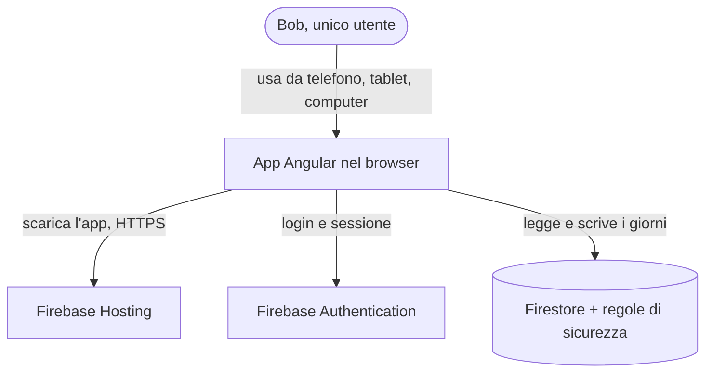
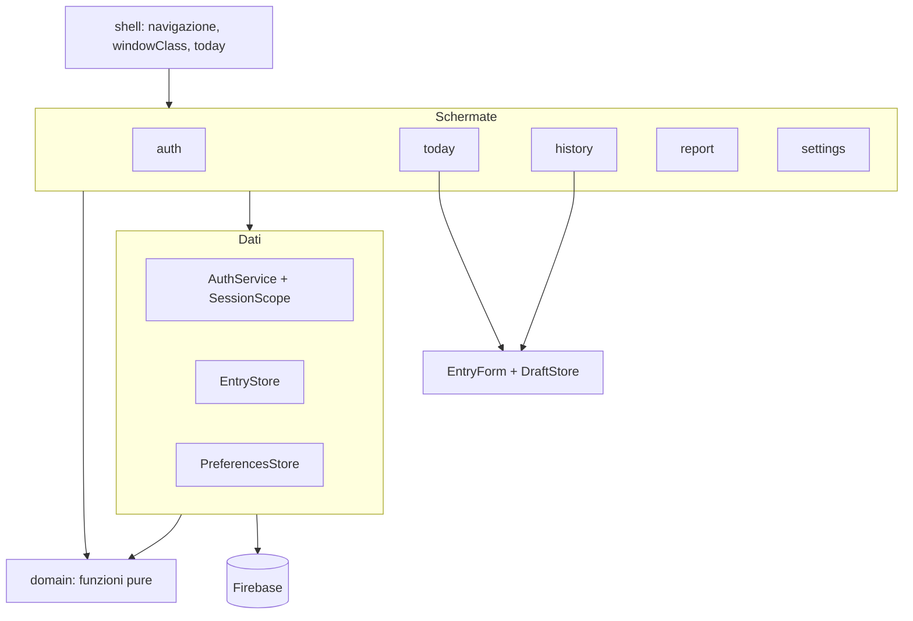
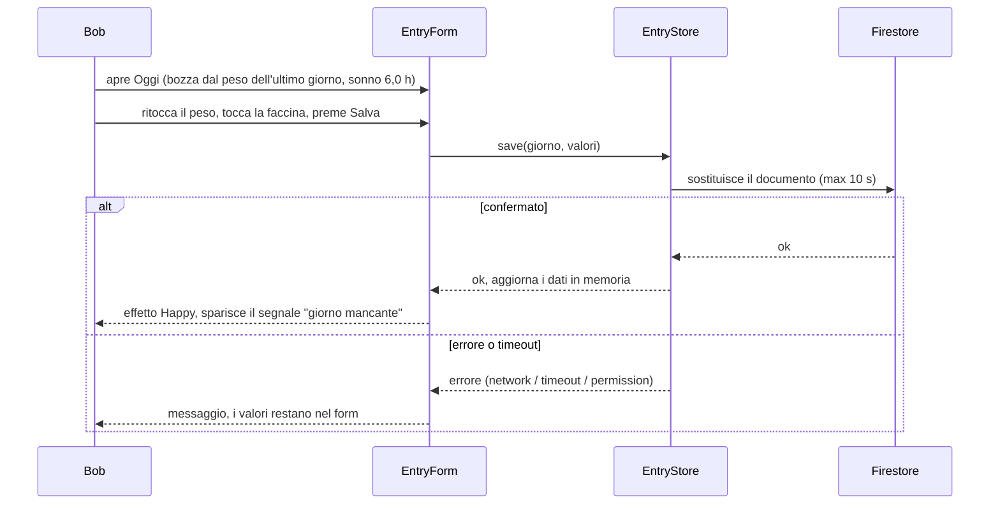

# Weight4All — Progetto della soluzione

Questo documento spiega in italiano, in modo discorsivo, come è fatta l'app. Il contratto per chi costruisce è `ARCHITECTURE-SPINE.md` (le regole AD-1 … AD-14). Se i due documenti divergono, vince lo spine.

## 1. In una frase

Weight4All è un'app web in Angular 22 che salva un record per ogni giorno (peso, umore, sonno) su Firestore, protetto da regole di sicurezza per utente, e li mostra in quattro schede: Oggi, Storico, Report, Impostazioni.

## 2. Il quadro generale (C4, livello contesto e contenitori)

Non c'è un server nostro. Il browser parla direttamente con Firebase, e a decidere chi può leggere o scrivere cosa sono le regole di sicurezza, non il codice dell'app.

## 3. Dentro l'app (C4, livello componenti)

Le schermate non parlano mai con Firebase. Passano solo dai tre servizi del livello dati, e solo `EntryStore` può salvare o cancellare un giorno. Tutti i calcoli (statistiche, giorni mancanti, linee tratteggiate, confronto per l'effetto Happy) sono funzioni pure in `domain`: si provano con test rapidi, senza Angular e senza Firebase.

## 4. Il dato

Ogni giorno è un documento: `users/{uid}/entries/AAAA-MM-GG`, con questi campi.

| Campo | Obbligatorio | Valori |
|---|---|---|
| `weight` | sì | 20,0 – 400,0 kg, un decimale |
| `mood` | no | intero da 1 a 10 |
| `sleep` | no | 0 – 24 ore, a mezz'ore |
| `updatedAt` | sì | data del server |

La data è anche il nome del documento, quindi un giorno non può avere due registrazioni. Un valore non inserito è un campo assente, mai zero. Il salvataggio sostituisce sempre il documento intero, così cancellare un valore lo toglie davvero. Le preferenze (colore d'accento e lingua) stanno in un documento a parte: `users/{uid}/preferences/app`.

Una misura nuova in futuro (attività fisica, alimentazione) è un nuovo campo facoltativo. I giorni vecchi non vanno toccati. Il prezzo di aver scelto campi separati è che la nuova misura va aggiunta in tre punti: l'elenco unico delle dimensioni, le regole di sicurezza e i test.

## 5. Come si salva un giorno (flusso principale, UJ-1)

L'app carica tutti i giorni dell'utente una sola volta dopo il login e li tiene in memoria. Storico, Report, "Questa settimana" e il segnale di giorno mancante si calcolano da lì, per questo il cambio di intervallo è immediato. Un giorno compare come salvato solo dopo la conferma del server.

## 6. Il Report e la linea tratteggiata

Per ogni misura e intervallo, una funzione pura prepara un punto per giorno, con valore oppure vuoto. Un punto che chiude un tratto dopo uno o più giorni vuoti è segnato "collegato". Chart.js disegna il tratto tratteggiato quando vede quel segno. Lo stesso procedimento serve il grafico combinato (una scala per linea) e i tre grafici singoli. Ogni grafico ha anche una tabella di testo con gli stessi dati, per l'accessibilità. Le statistiche usano solo i valori veri.

## 7. Lingua e aspetto

- **Testi:** un solo file `strings.ts` con italiano e inglese. Se manca una lingua, il progetto non compila. Il cambio lingua è immediato.
- **Numeri e date:** un solo modulo li legge, li arrotonda e li formatta (virgola in italiano, punto in inglese).
- **Aspetto:** Angular Material con tema M3. Sei colori d'accento, cambiabili a runtime. I colori delle tre misure nei grafici sono indipendenti dall'accento.

## 8. Dove vive e come si rilascia

| Ambiente | Dove | A cosa serve |
|---|---|---|
| `local` | Emulatore Firebase (richiede Java 21) | sviluppo e test |
| `prod` | Firebase Hosting + Firebase vero | l'app che usi |

Il rilascio è manuale (`firebase deploy`): prima le regole, solo dopo i test delle regole, poi l'app. Non c'è una pipeline automatica nella versione 1.

## 9. Come tenere le regole vere

Il progetto fallisce se qualcuno rompe le regole importanti: import di Firebase fuori dal livello dati, uso diretto dell'orologio, nomi di misure scritti a mano, testi scritti dentro i template. Tre livelli di test: funzioni pure (Vitest), regole di sicurezza (emulatore), percorsi completi (Playwright, a 360, 768 e 1280 px, completati in F4).

## 10. Rischi da tenere d'occhio

| Rischio | Cosa fa il progetto |
|---|---|
| Scrittura senza rete che resta appesa | Timeout di 10 secondi e messaggio d'errore |
| Dati di un account che finiscono in un altro | Sessione in tre stati, risultati marcati con l'utente, reset al logout |
| Tratteggio sul tratto sbagliato | Il segno "collegato" sta sul punto che chiude il tratto |
| Firebase 13 appena uscito | Restiamo su 12.19; l'aggiornamento è un lavoro a parte |
| Due dispositivi che modificano lo stesso giorno | Vince l'ultima scrittura (ipotesi da confermare) |

## 11. Da decidere più avanti

Tema scuro, intervallo personalizzato nel Report, CI e ambiente di prova, backup e monitoraggio, aggiornamento a Firebase 13. L'elenco completo è nella sezione "Deferred" dello spine.
